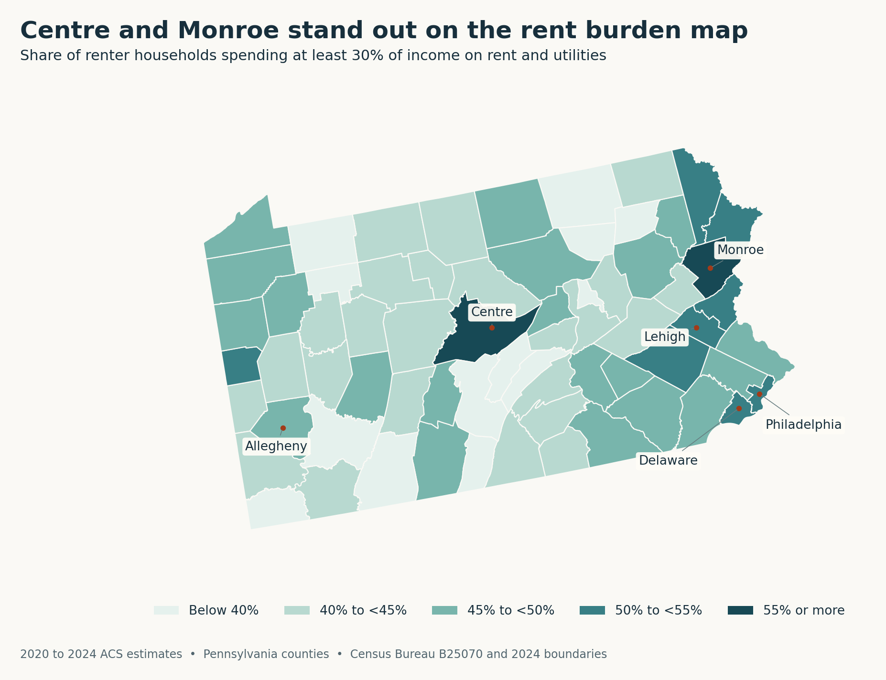
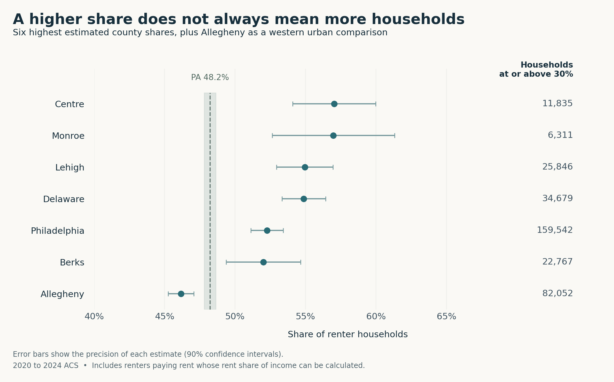

```{r}
#| include: false
s <- jsonlite::fromJSON("results/summary.json")
f <- function(x) sprintf("%.1f", x)
n <- function(x) format(round(x), big.mark = ",", scientific = FALSE, trim = TRUE)
n100 <- function(x) format(round(x, -2), big.mark = ",", scientific = FALSE, trim = TRUE)
cnty <- function(name, field = "burden_pct") s$counties[[name]][[field]]
```

Rent competes with groceries, the trip to work, and the money set aside for an emergency. When it takes a larger share of a household's income, something else has to give. An apartment can look inexpensive compared with Philadelphia and still be difficult to afford on a local paycheck.

That is why the geography matters. If housing assistance is planned around the assumption that rent pressure belongs mainly to the biggest city, renters elsewhere can be overlooked. Centre County, home to State College, and Monroe County in the Poconos challenge that picture. Both stand out on the map below.

I count households spending at least 30% of their income on rent and utilities. Crossing that line does not suddenly make a household unable to cope, but it flags how much of the budget housing absorbs. In Census estimates covering 2020 through 2024, `r f(cnty("Philadelphia"))`% of Philadelphia renters met that threshold, compared with `r f(s$outside_philly_pct)`% across the rest of Pennsylvania. The share was higher in the city, yet nearly half of renters elsewhere also met the threshold.

Here, “renters” means households paying rent whose rent share of income can be calculated. The comparison excludes households paying no rent or reporting zero or negative income. These are survey estimates spanning five years, not a snapshot of today's rental market.

The map covers all `r s$county_count` counties. Darker colors show a larger share of renters meeting the threshold. They do not show higher rents or more households.

```{r}
#| label: fig-county-map
#| echo: false
#| fig-cap: "Centre and several eastern counties stand out; estimates for small counties such as Forest, Cameron, and Elk are less precise than the colors suggest."
#| fig-alt: "Pennsylvania county map showing the share of eligible renter households spending at least 30 percent of income on rent and utilities, with high shares in Centre, Monroe, Lehigh, Delaware, and Philadelphia."

```

Centre's share was `r f(cnty("Centre"))`%, almost identical to Monroe's `r f(cnty("Monroe"))`%. Lehigh and Delaware also had high shares. These places do not all have the same housing market, which is part of the point.

Centre's [2023 housing assessment](https://centrecountypa.gov/DocumentCenter/View/25310/Centre-County-2023-HNA_Final_6_20_2023) connects high burdens in student neighborhoods near Penn State partly to low student incomes. The mix of renters may therefore help explain its position, without telling us that students face no hardship. [Monroe's housing study](https://www.monroecountypa.gov/getmedia/963f4915-2714-4d21-a7d8-449339ca3b9b/20230922_1_AffHousing.pdf) describes people relocating from costlier New York and New Jersey alongside a shortage of rentals affordable at local incomes. In the [Lehigh Valley](https://lvpc.org/housing), planners identify housing construction that has lagged population growth. These reports suggest possible explanations; the map cannot measure their contribution.

Nor can color settle a ranking. The next chart shows the six highest county estimates, plus Allegheny as a western urban comparison. The error bars show how precise each number is. Centre and Monroe should not be treated as a clear first and second place.

```{r}
#| label: fig-county-comparison
#| echo: false
#| fig-cap: "Philadelphia has a lower share than Centre but far more households meeting the threshold."
#| fig-alt: "Dot chart with 90 percent uncertainty intervals for Centre, Monroe, Lehigh, Delaware, Philadelphia, Berks, and Allegheny, a statewide reference of about 48 percent, and affected household counts alongside."

```

The counts change the story. Philadelphia had about `r n100(cnty("Philadelphia", "burdened_households"))` households meeting the threshold, compared with `r n100(cnty("Centre", "burdened_households"))` in Centre. Philadelphia alone accounted for `r f(s$philly_share_burdened)`% of the statewide total. Allegheny's lower share still represented about `r n100(cnty("Allegheny", "burdened_households"))` households. A darker county is not automatically where assistance could reach the most renters. Shares show how widespread the pressure is locally; counts show how many households are affected.

The pressure is often more than a narrow crossing of the 30% line. Statewide, `r f(s$state$severe_pct)`% of renters spent at least half their income on housing. That leaves at most half for everything else. For a housing organization, the lesson is to look beyond Philadelphia without losing sight of the much larger number of households affected there.

County averages cannot identify which families need help or separate the effects of low incomes and high rents. Excluded households can also face hardship. The map is a starting point for deciding where to look more closely, not a substitute for understanding local households.

The main takeaways are:

* Rent pressure reaches college communities and the Poconos as well as Philadelphia.
* Philadelphia's share is higher than the rest of the state's, but nearly half of renters elsewhere also meet the threshold.
* Centre's high share and Philadelphia's much larger count point to different scales of housing need. Assistance planning should consider both.

Data come from the Census Bureau's [2020 to 2024 ACS table B25070](https://data.census.gov/table/ACSDT5Y2024.B25070), its [variance replicate estimates](https://www.census.gov/programs-surveys/acs/data/variance-tables.html), and [2024 county boundaries](https://www2.census.gov/geo/tiger/GENZ2024/shp/). [GitHub repository](https://github.com/yipin-grena/aeds6400-blog).
