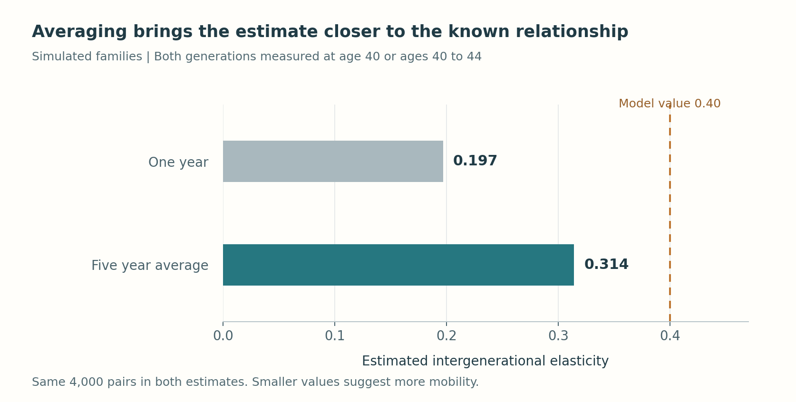
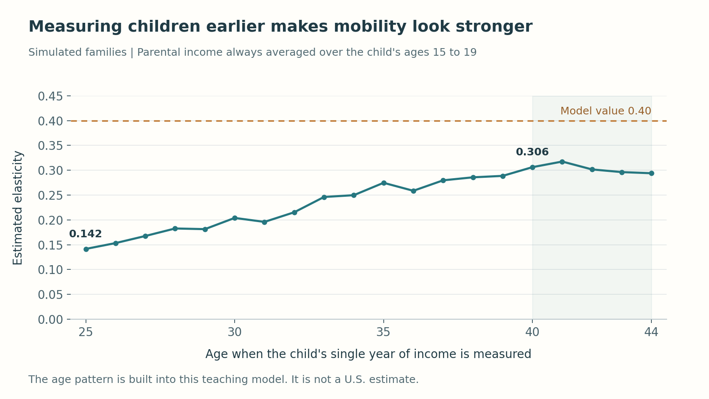

```{r}
#| include: false
s <- jsonlite::fromJSON("results/summary.json")
f <- function(x) sprintf("%.2f", x)
n <- function(x) format(x, big.mark = ",", scientific = FALSE, trim = TRUE)
show_code <- function(path, language, section = NULL) {
  lines <- readLines(path, warn = FALSE)
  if (!is.null(section)) {
    start <- which(lines == paste("# BEGIN", section)) + 1
    end <- which(lines == paste("# END", section)) - 1
    lines <- lines[start:end]
  }
  cat(paste0("\n```", language, "\n", paste(lines, collapse = "\n"), "\n```\n"))
}
```

Could income mobility look stronger simply because we measured people in the wrong year? A parent might receive an unusually large bonus, while their adult child is still building a career. Neither income necessarily reflects what that person usually earns. Mistaking these temporary differences for lasting ones could make economic opportunity appear more open than it is.

This has happened in real research. [Solon (1992)](https://ideas.repec.org/a/aea/aecrev/v82y1992i3p393-408.html) showed that earlier U.S. estimates were biased downward by measurement error, unrepresentative samples, or both; using the Panel Study of Income Dynamics, he found a long-run intergenerational correlation of at least 0.4, implying much less mobility than earlier work suggested. [Mazumder (2005)](https://ideas.repec.org/a/tpr/restat/v87y2005i2p235-255.html) later used Social Security earnings histories and found that averaging fathers' earnings over only a few years understated the elasticity by roughly 30% or more, putting it near 0.6. How income was measured changed what economists concluded about opportunity in the United States.

To see why, I use SQL inside Python to match `r n(s$n)` **simulated families**, each with one parent and one child. Averaging several years reveals a stronger income connection than a single year does, even though the families are unchanged. These are teaching data with a known underlying relationship, not estimates for the United States.

## Match the people before comparing their incomes

Follow the [README's setup instructions](https://github.com/yipin-grena/aeds6400-blog/tree/main/posts/sql-income-mobility), then run `python run.py` and `python tutorial.py` from this post's folder. The first builds the data and SQLite database; the second runs the matching and comparisons below. Three tables carry the analysis.

| Table | One row represents | Important columns |
|---|---|---|
| `people` | A person | `person_id`, `family_id`, `birth_year`, `generation` |
| `links` | A known parent and child relationship | `family_id`, `parent_id`, `child_id` |
| `incomes` | A person in a calendar year | `person_id`, `year`, `real_income` |

`family_id` follows the family of origin after the child moves out. The relationship table identifies the specific parent; sharing a household alone does not establish parenthood. Here that table is given, which keeps the tutorial focused on the query. In a real panel such as the Panel Study of Income Dynamics, building it is part of the work: links come from family and person identifiers combined with each person's recorded relationship to the household head, and a study must decide how to handle two parents, siblings, and people who leave the survey.

The query in `sql/match.sql` summarizes each person's income before joining the generations. Otherwise, two five-year histories would produce 25 combinations. I match family and person identifiers, not calendar years: parents and children reach the same age in different years.

```{r}
#| echo: false
#| results: asis
show_code("sql/match.sql", "sql")
```

The query works in four steps.

1. **Join each person to their yearly incomes.** Each `WITH` block starts from `people` and uses `JOIN` to attach that person's rows from `incomes` wherever the `person_id` values match. `SELECT` keeps only what later steps need: the two identifiers and the income measure.
2. **Line the generations up by age, not by calendar year.** The `incomes` table records years, but parents and children should be compared at the same point in life. `i.year - p.birth_year` turns each year into the person's age, and `WHERE ... BETWEEN :p_start AND :p_end` keeps only the chosen ages. Names that begin with a colon are placeholders that Python fills in, so one query serves every comparison below.
3. **Collapse each person's years into one number.** `GROUP BY p.family_id, p.person_id` gathers all of one person's selected years, and the aggregate function `AVG(i.real_income)` turns them into a single income. `HAVING` then checks each finished group: `COUNT(DISTINCT i.year)` must equal the number of ages requested, so a person missing a year is dropped instead of being averaged over fewer years.
4. **Attach both summaries to each relationship.** The final `SELECT` starts from `links` and joins the parent summary and the child summary on both `family_id` and the person identifier. The result has one row per child, holding both generations' incomes.

With ages 40 through 44 for both generations, the first rows of the result look like this. Each income is a five-year average in constant dollars.

```{r}
#| echo: false
pairs <- read.csv("results/tables/example-pairs.csv")
pairs$parent_income <- paste0("$", n(round(pairs$parent_income)))
pairs$child_income <- paste0("$", n(round(pairs$child_income)))
knitr::kable(
  pairs,
  col.names = c("Family", "Parent ID", "Child ID", "Parent income", "Child income"),
  align = "rrrrr"
)
```

The Python helper sends the age limits to this query and retrieves a pandas table. Changing those limits lets us compare income measures without changing the families.

<details>
<summary>Show the Python helper that runs the SQL query</summary>

```{r}
#| echo: false
#| results: asis
show_code("tutorial.py", "python", "setup")
```

</details>

## Estimate persistence, then change the measurement window

How closely do the generations' incomes move together? The intergenerational elasticity, or IGE, measures that connection. With the model's IGE of `r f(s$true_ige)`, 10% higher parental income is associated with about `r sprintf("%.0f", 100 * (1.10^s$true_ige - 1))`% higher child income. A smaller value suggests less persistence and more mobility. It is an association, not a causal effect.

To estimate it, fit a line to the natural logarithms of the matched incomes. The slope, $\beta$, is the IGE.

$$
\log(\text{child income}) = \alpha + \beta\log(\text{parent income}) + \varepsilon.
$$

SQL averages annual income amounts in constant dollars **before** Python takes logarithms. In the code, `np.ones` supplies the intercept and `np.linalg.lstsq` fits the line. The checks keep each child once and the families identical across comparisons.

<details>
<summary>Show the Python code that estimates and compares the slopes</summary>

```{r}
#| echo: false
#| results: asis
show_code("tutorial.py", "python", "estimate")
```

</details>

Using age 40 alone gives `r f(s$single)`; averaging ages 40 through 44 raises it to `r f(s$averaged)`, closer to the model's `r f(s$true_ige)`. The families did not become less mobile. Better measurement revealed more of the income connection already built into the simulation.

```{r}
#| label: fig-averaging
#| echo: false
#| fig-cap: "Averaging several years reduces the distortion from temporary income fluctuations in this simulation."
#| fig-alt: "Two bars comparing simulated elasticity estimates from one year and five-year average incomes, with a dashed line at the model value of 0.4."

```

Temporary swings in parental income blur its relationship with the child's income, pushing the slope toward zero. Averaging reduces that distortion. Independent swings in child income mainly make estimates less precise. Five years still imperfectly measure lasting income, and chance also affects this simulated sample.

## Averaging cannot fix measuring children too young

But does averaging solve the whole problem? Holding parental income at its five-year average, I change only the child's measurement age. The slope rises from `r f(s$child25)` at 25 to `r f(s$child40)` at 40. Early incomes hide differences that emerge later. The small dips along the way, such as at ages 28 and 41, are sampling noise in this one simulated sample, not part of the pattern.

```{r}
#| label: fig-child-age
#| echo: false
#| fig-cap: "Changing the child's measurement age changes the estimated persistence even with the same parents and families."
#| fig-alt: "Line chart of simulated elasticity by child age, generally rising from age 25 to age 40 and then leveling off, with parent income always averaged over ages 40 through 44."

```

This illustrates **life-cycle bias**. Children with higher lasting incomes have steeper early income growth in the model. If everyone's income grew by the same percentage, that alone would not change the slope. The age pattern is deliberately built in, not discovered in real data. [Haider and Solon](https://www.nber.org/papers/w11943) explain why current earnings can represent lifetime earnings differently at different ages.

Even averaging the child's ages 25 through 29 gives only `r f(s$young_average)`. More observations still describe an early career. Real data also require decisions about missing years and zero incomes, which this complete, positive-income simulation avoids.

The main takeaways are:

* Match explicit parent and child identities, then check that each pair appears once.
* Average several years to reduce temporary fluctuations that can make mobility look stronger.
* Compare suitable ages too. Averaging early earnings does not make them representative of a whole career.

[Code, model assumptions, and replication instructions](https://github.com/yipin-grena/aeds6400-blog/tree/main/posts/sql-income-mobility).
