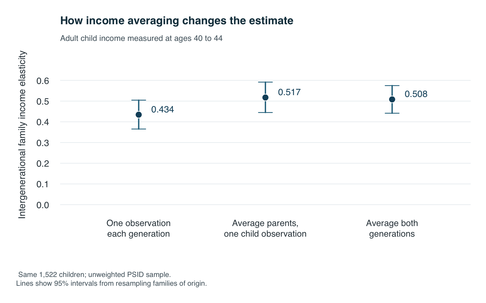
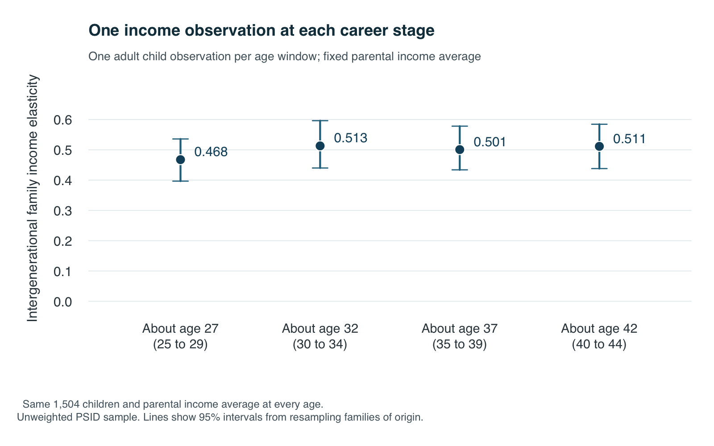

```{r}
#| include: false
e <- read.csv("results/real/estimates.csv", stringsAsFactors = FALSE)
f <- function(x) sprintf("%.3f", x)
n <- function(x) format(x, big.mark = ",", scientific = FALSE, trim = TRUE)
value <- function(key) e$ige[match(key, e$measure)]
single <- value("one_year_each")
parent_only <- value("averaged_parent_one_year_child")
averaged <- value("averaged_each_age40_44")
lc <- read.csv("results/real/lifecycle-estimates.csv", stringsAsFactors = FALSE)
lc_diff <- read.csv("results/real/lifecycle-contrasts.csv", stringsAsFactors = FALSE)
life_value <- function(key) lc$ige[match(key, lc$measure)]
life_early <- life_value("child_single_age25_29")
life_late <- life_value("child_single_age40_44")
life_difference <- lc_diff[lc_diff$comparison == "child_single_age40_44 minus child_single_age25_29", ]
coverage <- read.csv("results/real/coverage.csv", stringsAsFactors = FALSE)
obs <- function(key) coverage$median_observations[match(key, coverage$measure)]
show_code <- function(path, language, function_name = NULL) {
  lines <- readLines(path, warn = FALSE)
  if (!is.null(function_name)) {
    start <- grep(paste0("^def ", function_name, "\\("), lines)
    following <- grep("^def ", lines)
    following <- following[following > start]
    end <- if (length(following)) min(following) - 1 else length(lines)
    lines <- lines[start:end]
  }
  cat(paste0("\n```", language, "\n", paste(lines, collapse = "\n"), "\n```\n"))
}
```

Could a single year's income make economic opportunity look more open than it is? A bonus, a layoff or the start of a career may say little about a family's usual resources. Mistaking temporary differences for lasting ones could weaken the measured connection between parents and children.

I match real [Panel Study of Income Dynamics](https://psidonline.isr.umich.edu/) records using SQL inside Python. The averaging comparison uses `r n(e$children[1])` adult children. A second comparison changes the child's measurement age while keeping parental income fixed.

## Build the match

The [replication guide](https://github.com/yipin-grena/aeds6400-blog/tree/main/posts/sql-income-mobility) lists the variables and setup. Python reads the Excel extracts and creates four tables in memory. R checks the aggregate outputs and draws the figures.

| Table | One row represents | Key |
|---|---|---|
| `people` | One person | `id68`, `pn` |
| `parent_links` | One child and a biological parent | Child ID and parent type |
| `person_years` | One current family member in a wave | Person ID and survey year |
| `family_years` | One family's income in a wave | Survey year and interview number |

The [FIMS parent map](https://simba.isr.umich.edu/FIMS/FIMS_UG.pdf) supplies each parent's ID. The 1968 family identifier, `id68`, and person number, `pn`, identify someone together. A family's interview number identifies it only within a survey year.

1. **Join the people.** `JOIN` connects parent links to yearly records using complete person IDs. Matching survey year and interview number identifies a co-resident parent who is a reference person or spouse/partner.
2. **Find the income.** Another `JOIN` attaches family income using survey year and interview number. `SELECT` keeps needed columns. Income covers the previous calendar year, so interview age minus one approximates income age.
3. **Count each household once.** Two parents can supply the same income. `SELECT DISTINCT` removes that duplicate. `GROUP BY` gathers observations, and `AVG` calculates parental income. `HAVING` requires at least three observations around child ages 15 to 19.
4. **Repeat for adulthood.** The query averages the child's family income as a reference person or spouse/partner, requiring two observations per age window. The final join produces one row per child.

<details>
<summary>Show the complete matching SQL</summary>

```{r}
#| echo: false
#| results: asis
show_code("sql/match_real.sql", "sql")
```

</details>

With biennial interviews from 1999, these averages contain a median of `r obs("parent_15_19")` parental observations and `r obs("child_40_44")` mature adult observations. SQL also selects one observation nearest each age-window midpoint, breaking ties toward the earlier year.

Python passes age limits through `pd.read_sql_query`. Run `python tutorial_real.py` for a complete example with imports, database setup and comparison calls. The guide explains how to match other years.

<details>
<summary>Show the complete Python setup and comparison example</summary>

```{r}
#| echo: false
#| results: asis
show_code("tutorial_real.py", "python")
show_code("real_analysis.py", "python", "query_pairs")
```

</details>

## Compare the income measures

The intergenerational elasticity, or IGE, is the slope in

$$
\log(\text{adult child family income}) = \alpha + \beta\log(\text{parental family income}) + \varepsilon.
$$

At the averaged estimate, 10% higher parental income is associated with about `r sprintf("%.1f", 100 * (1.1^averaged - 1))`% higher adult child family income. Higher IGE means greater persistence. Income is averaged in 2022 dollars before taking logarithms. `np.linalg.lstsq` fits the line; uncertainty calculations account for related children.

<details>
<summary>Show the Python regression and uncertainty calculation</summary>

```{r}
#| echo: false
#| results: asis
show_code("real_analysis.py", "python", "slope_and_cluster_se")
```

</details>

Figure 1 gives `r f(single)` using one observation per generation and `r f(averaged)` using averages. Averaging parental income alone gives `r f(parent_only)`; averaging adult income does not raise the point estimate further. Multiple observations can reduce an unusual year's influence, but need not increase the estimate.

```{r}
#| label: fig-averaging
#| echo: false
#| fig-cap: "The same children show a stronger income connection when parental income is averaged. Lines show 95% intervals from resampling families of origin."
#| fig-alt: "Three real PSID estimates compare one observation per generation, averaging parental income only, and averaging both generations for the same children. Lines show family bootstrap intervals."

```

## Check the child's career stage

Figure 2 uses one child income observation near ages 27, 32, 37 and 42, with parental income fixed. Requiring positive selected incomes at every stage leaves `r n(lc$children[1])` children, held constant across ages. The youngest and oldest estimates are `r f(life_early)` and `r f(life_late)`. Their difference has a 95% interval from `r f(life_difference$ci_lower)` to `r f(life_difference$ci_upper)`, including zero, so the age evidence is inconclusive.

```{r}
#| label: fig-child-age
#| echo: false
#| fig-cap: "One income observation at each career stage gives different point estimates but no steady age gradient. Lines show 95% family bootstrap intervals."
#| fig-alt: "Four PSID estimates use one selected child income observation near ages 27, 32, 37 and 42 on the same sample. Estimates are not monotonic and their family bootstrap intervals overlap."

```

**Life-cycle bias** remains a concern. Hypothetically, if early-career log-income gaps are half their lifetime size, the estimated slope would be halved too. [Haider and Solon (2006)](https://doi.org/10.1257/aer.96.4.1308) explain why career snapshots can misrepresent lasting income. Averaging several early years may still miss later differences.

These unweighted results describe selected families. Calendar periods and family circumstances change with age. Family income includes partners' resources, and membership is observed at interview. The true lifetime IGE remains unknown; these associations establish no causal effect.

The main takeaways are:

* Match full person IDs and the correct family-year, then remove duplicate household incomes.
* Averaging parental income reveals a stronger connection here; its effect differs across generations.
* One career snapshot need not represent lifetime resources; this sample's age comparison remains inconclusive.

[Data sources, code and replication instructions](https://github.com/yipin-grena/aeds6400-blog/tree/main/posts/sql-income-mobility).
